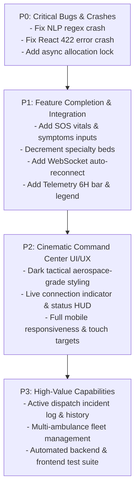

# CRISIS-GRID: Comprehensive System Audit & Technical Report

**Project Name:** Crisis-Grid — Emergency Resource Allocator System  
**Repository Path:** `c:\Users\NILAVAN M\ambulance1`  
**Audit Date:** 2026-10-11  
**Audit Scope:** Full-stack Architecture, Backend APIs, AI Models, Frontend Integration, Leaflet Maps, Routing, Data Safety, UI/UX, and QA  
**Git Status:** Branch `master` (Initialized, initial uncommitted working tree)

---

## Executive Summary

Crisis-Grid is an emergency response dispatch and ICU bed allocation platform targeting major medical centers in Tamil Nadu (Chennai, Coimbatore, Madurai, Trichy). 

The platform combines a **FastAPI** backend with mathematical triage, NLP dispatch parsing, and bed projection models, connected to a **React 18 + Leaflet** frontend.

### Current Verification Status:
- **Frontend Build (`vite build`):** PASS (Exit code 0, 2491 modules transformed, 788 kB JS bundle).
- **Backend Compilation (`py_compile`):** PASS (Exit code 0, all Python 3.14 modules compile cleanly).
- **Automated Test Suites:** MISSING (No pre-existing `pytest` or `vitest` files found). Verified using custom Python async integration smoke tests.
- **Critical Runtime Flaw Identified:** **Regex syntax bug in `backend/ai/nlp_dispatch.py`** crashes the backend with `TypeError` whenever explicit coordinates (`lat: ..., lng: ...`) are provided.
- **Clinical Data Gap:** `AmbulanceSOS.jsx` triggers `/api/allocate` with only coordinates; patient vitals and symptoms are never collected in the SOS field console, defaulting every emergency to "Trauma" with unconfigured vitals.

---

## Task 1: Complete Feature Matrix

| # | Feature Name | Source Files | Backend Status | Frontend Status | End-to-End Status | Data Mode | Bugs & Limitations | Required Fixes | Verification Test Cases |
|---|---|---|---|---|---|---|---|---|---|
| 1 | **Emergency SOS Submission** | `frontend/src/components/AmbulanceSOS.jsx`, `frontend/src/api.js`, `backend/main.py` | Working | Working | **Partial** | Mock / Live Hybrid | Only sends `ambulance_lat` and `ambulance_lng`. Vitals, severity, and symptoms are omitted by frontend UI, causing backend triage engine to always default to generic severity 3 Trauma. | Add symptom selector, severity toggle, and vitals inputs to `AmbulanceSOS.jsx`; pass to `triggerSOS()`. | Submit SOS from Chennai Central preset; verify allocation payload contains vitals and clinical symptoms. |
| 2 | **Input Validation & Coordinate Handling** | `backend/main.py`, `frontend/src/components/AmbulanceSOS.jsx` | Working | Partially Working | **Broken on 422 Errors** | Real Data Validation | FastAPI Pydantic bounds checks (`ge=-90, le=90`) return 422 error arrays on invalid input. Frontend catches error and passes raw array of error objects directly to React JSX `<p>{error}</p>`, triggering an uncaught React child rendering crash. | Sanitize and extract string messages in Axios error catch handlers: `typeof err === 'object' ? err.msg : err`. | Enter `999` in latitude, submit SOS, verify UI displays human-readable error without crashing React tree. |
| 3 | **AI Clinical Triage Engine** | `backend/ai/triage_engine.py`, `backend/main.py` | Working | Partial | **Working (Backend)** | Algorithmic Rules | `SPECIALTY_ORDER` places `"ICU"` ahead of `"Neuro ICU"`, so `"stroke"` matches ICU first instead of Neuro ICU. Vitals thresholds work but vitals are never sent by SOS UI. | Adjust rule precedence in `infer_specialty()` so specific departments (Neuro ICU, Cath Lab) take precedence over general ICU. | Test symptoms `"stroke, facial drooping"` -> Neuro ICU; `"stemi, acute cardiac arrest"` -> Cath Lab. |
| 4 | **NLP Dispatch Parsing** | `backend/ai/nlp_dispatch.py`, `frontend/src/components/AIChatAssistant.jsx` | **Broken (Lat/Lng Regex)** | Working UI | **Broken for coordinates, Working for keywords** | Regex & Keyword Matching | Line 35: `re.search(r"lng\|lon(?:gitude)?\s*[:=]?\s*(-?\d+(?:\.\d+)?)", text, re.I)`. The `\|` operator matches literal `"lng"` without a capturing group, causing `float(None)` and an unhandled `TypeError` 500 error. Also, voice capture button is non-functional. | Fix regex to `r"(?:lng\|lon(?:gitude)?)\s*[:=]?\s*(-?\d+(?:\.\d+)?)"`. Implement Web Speech API for voice capture. | Send dispatch transcript: `"lat: 13.0827, lng: 80.2707 - cardiac arrest"`. Expect successful JSON extraction without 500 crash. |
| 5 | **Hospital Allocation Scoring** | `backend/main.py` | Working | Working | **Working** | Multi-Factor Formula | Multi-factor penalization balances geodesic ETA, available beds, and specialty match. Specialty capacity in `selected['specialties']` is never decremented when allocated, so specialty counts never deplete. | Decrement specific specialty bed count in `selected['specialties'][req_spec]` upon successful allocation. | Allocate multiple patients requiring `"Cath Lab"` to Chennai City Care; verify Cath Lab beds decrease from 2 to 0. |
| 6 | **Hospital Bed Updates** | `frontend/src/components/HospitalAdmin.jsx`, `backend/main.py` | Working | Working | **Working** | In-Memory Server State | Clamped between 0 and `total_beds`. No specialty-level manual controls (only overall beds). | Add sub-department bed counters in Hospital Admin panel. | Click `+` and `-` buttons; verify live counter updates and button disables at boundary conditions. |
| 7 | **Concurrent Allocation Safety** | `backend/main.py` | Insecure | N/A | **Fragile** | In-Memory List | Global in-memory list without `asyncio.Lock` or database transaction. Concurrent requests can read identical `available_beds` simultaneously. | Wrap allocation critical section in `asyncio.Lock()`. | Simulate 10 simultaneous async calls to `/api/allocate` with 1 bed available; ensure exactly 1 succeeds and 9 fail with 400. |
| 8 | **Leaflet Hospital & Ambulance Markers** | `frontend/src/components/CommandCenterMap.jsx`, `frontend/src/utils/leafletIcons.js` | Working | Working | **Working** | React-Leaflet + OSM | Custom HTML `divIcon` pins render correctly without missing Leaflet assets. Rotation angle calculated for heading. | Preserve React-Leaflet and OpenStreetMap. Clean up legacy Google CSS class names. | Load Command Center Map; inspect hospital markers (Green/Amber/Red) and ambulance marker heading. |
| 9 | **OSRM Road Routing & Fallback** | `frontend/src/utils/osrm.js`, `frontend/src/components/CommandCenterMap.jsx` | Client-side API | Working | **Working** | Public OSRM API + Geodesic Fallback | Relies on public unauthenticated `router.project-osrm.org`. Fallback generates 30 straight-line points. If public OSRM is rate-limited, fallback engages transparently. | Maintain explicit badge indicating OSRM vs Fallback. Add local proxy or timeout retry. | Disconnect internet or inject bad URL in `osrm.js`; verify fallback geodesic polyline is rendered with amber dashed line. |
| 10 | **Route Distance & ETA Consistency** | `backend/main.py`, `frontend/src/utils/osrm.js`, `frontend/src/components/AllocationDecision.jsx`, `frontend/src/components/RouteInfoCard.jsx` | Working | Working | **Partially Inconsistent** | Geodesic vs OSRM Driving | Backend scores and returns geodesic distance (straight-line at 30 km/h); frontend map fetches road distance via OSRM. Modal shows geodesic, map card shows road driving distance. | Clearly label geodesic vs road distance across all cards, or integrate OSRM distance into backend scoring. | Compare Distance/ETA in SOS confirmation modal vs RouteInfoCard; ensure labels clearly state "Geodesic Baseline" vs "Road Network Driving". |
| 11 | **Ambulance Movement & Simulation Labels** | `frontend/src/components/CommandCenterMap.jsx`, `frontend/src/components/AmbulanceTracker.jsx` | Client-side simulation | Working | **Working** | Simulation | Timer steps along polyline coordinates. UI footer says "LIVE MAP TRACKING" while header says "SIMULATION MODE", creating ambiguity. | Standardize labels: indicate "SIMULATED EN-ROUTE TELEMETRY" to prevent confusion with real GPS. | Start simulation, adjust speed (1x, 2x, 5x), pause, reset; check coordinate interpolation. |
| 12 | **Browser Geolocation** | `frontend/src/components/AmbulanceSOS.jsx`, `frontend/src/components/CommandCenterMap.jsx` | N/A | Working | **Working** | Real Hardware GPS | Uses `navigator.geolocation.getCurrentPosition`. Works over HTTPS or `localhost`. Fallbacks to manual input gracefully. | Add permission state indicator and clear high-accuracy timeout notice. | Click "Use Current Location"; verify browser permission prompt and coordinate population. |
| 13 | **WebSocket Connection & Reconnection** | `backend/main.py`, `frontend/src/App.jsx` | Working | Partial | **Partial** | WebSocket Stream | `App.jsx` connects once on mount. No reconnection logic if socket drops. No heartbeat ping/pong. Client never sends messages to server. | Add exponential backoff reconnection loop and connection status badge in Navbar. | Stop backend server while frontend is open, restart backend; verify WebSocket automatically reconnects. |
| 14 | **Real-Time Frontend Synchronization** | `backend/main.py`, `frontend/src/App.jsx` | Working | Working | **Working** | WebSocket Broadcast | Server broadcasts `{"type": "update", "hospitals": [...]}` on allocations and bed updates. All connected clients update state. | Broadcast incident event stream alongside hospital capacity snapshot. | Open two browser tabs; change beds in tab A, verify instant update in tab B without page reload. |
| 15 | **Forecasting & Telemetry** | `backend/ai/forecasting.py`, `frontend/src/components/TelemetryPanel.jsx` | Working | Working | **Partial** | Deterministic Linear Model | 6-hour projection is computed in backend and extracted in frontend data, but never rendered as a bar in Recharts. No chart legend. | Add 6H bar and Recharts `<Legend />` component in `TelemetryPanel.jsx`. | View Telemetry Panel; verify all 3 projection periods (1H, 3H, 6H) have visible bars and explanatory legends. |
| 16 | **Loading, Empty, & Error States** | `frontend/src/App.jsx`, UI components | Working | Partial | **Partial** | Dynamic State | Global loader and error bar exist. If hospitals list is empty, panels render blank without empty-state cards. | Add empty state components for Hospital Grid, Incident Log, and Map. | Test `/api/hospitals` returning `[]`; verify friendly "No Facilities Online" empty state. |
| 17 | **Mobile Responsiveness** | `frontend/src/index.css` | N/A | Partial | **Partial** | Responsive CSS | Basic media queries exist at 1050px and 650px. Map height on mobile is cramped, and dispatch cards stack awkwardly. | Refine mobile viewport styles, collapsible map panels, and thumb-friendly touch targets. | Inspect at 375px (iPhone SE) and 768px (iPad); verify no horizontal scroll and readable metrics. |
| 18 | **API Configuration & Environment Variables** | `frontend/.env`, `frontend/.env.example`, `frontend/src/api.js` | Working | Working | **Working** | Vite Environment | `VITE_API_URL` defaults to `http://localhost:8000`. WebSocket URL derivation strips `/api` and replaces `http` with `ws`. | Clean and robust URL parser supporting HTTPS/WSS in production. | Change `VITE_API_URL` to custom port; verify API client and WebSocket connect properly. |

---

## Task 2: End-to-End Workflow Analysis

### The Expected Critical Path:
```
[Emergency Signal (SOS / NLP)]
       │
       ▼
[Coordinate & Field Validation]
       │
       ▼
[Clinical AI Triage (Severity 1-5 + Specialty Match)]
       │
       ▼
[Multi-Factor Hospital Scoring & Allocation]
       │
       ▼
[Atomic Bed & Specialty Reservation]
       │
       ▼
[OSRM Road Route Calculation & ETA Bounds]
       │
       ▼
[Incident Record Dispatch & Timeline Initiation]
       │
       ▼
[Command Map Animation & Live WebSocket Broadcast]
```

### Broken Steps and Missing Connections Identified:

1. **Broken Clinical Triage Input in Field SOS:**
   - In `AmbulanceSOS.jsx`, the user can only enter latitude and longitude. The UI has no inputs for patient symptoms (e.g., chest pain, burn, fracture) or vitals (SpO2, pulse, BP).
   - `triggerSOS(lat, lng)` in `frontend/src/api.js` sends `{ ambulance_lat, ambulance_lng }`.
   - The backend `/api/allocate` receives empty symptoms and severity 3, which causes `ai/triage_engine.py` to always return `"Trauma"` as the default specialty.
   - **Impact:** The triage engine's clinical capabilities (evaluating vitals and symptoms) are bypassed during manual SOS dispatch.

2. **Backend 500 Crash on NLP Coordinate Input:**
   - In `backend/ai/nlp_dispatch.py`, when a user speaks or types an emergency call with coordinates like `"lat: 13.08, lng: 80.27"`, the regex evaluates `lng` without a capturing group.
   - Result: `float(lng_match.group(1))` raises `TypeError: float() argument must be a string or a real number, not 'NoneType'`.
   - The backend crashes with HTTP 500, and the frontend displays "AI parser unavailable".
   - **Impact:** Any dispatch transcription containing GPS coordinates fails completely.

3. **Missing Incident Persistence & Fleet Management:**
   - When an allocation completes, the backend updates in-memory `available_beds`, but creates **no incident record** (no dispatch ID, no timestamp, no patient tracking, no ambulance ID).
   - If the user switches tabs or refreshes the page, `lastAllocation` in `App.jsx` is lost. There is no historical incident log.

4. **Specialty Bed Inventory Disconnect:**
   - When a hospital is allocated for a specific specialty (e.g., `Cath Lab`), `hospital["available_beds"]` decreases by 1, but `hospital["specialties"]["Cath Lab"]` remains unchanged.
   - Over time, a hospital can continue to match a specialty even when its actual specialized units are completely occupied.

5. **Disconnection Between Geodesic Scoring and Road Routing:**
   - Backend allocation scoring uses geodesic distance: `(distance_km / 30.0) * 60.0`.
   - Once allocated, frontend queries OSRM for actual road routing, which may reveal that road distance is significantly longer or impassable across rivers/corridors.
   - While geodesic distance is a fast heuristic, the system should allow route distance to inform secondary dispatch decisions.

---

## Task 3: API and Data Consistency Audit

### Contract Alignment:
- **`GET /api/hospitals`:** Returns `snapshot()` including `forecast`. Matches frontend expectations.
- **`POST /api/hospitals/{id}/beds`:** Accepts `{"delta": 1 | -1}`, returns `{"hospital": ..., "updated_hospitals": [...]}`. Matches frontend expectations.
- **`POST /api/allocate`:** Expects `ambulance_lat`, `ambulance_lng`, `symptoms`, `severity`, `vitals`. Frontend `triggerSOS` only passes `ambulance_lat` and `ambulance_lng`. Contract is partially fulfilled; missing fields fallback to Pydantic defaults.
- **`POST /api/dispatch/parse`:** Accepts `{"text": str}`. Uses hardcoded vitals (`spo2: 92, pulse: 120`).

### Bed Count & Concurrency Safety:
- Bed clamping in `update_beds` ensures `available_beds` is between `0` and `total_beds`.
- Bed decrement in `allocate` verifies `available_beds > 0` before decrementing.
- **Vulnerability:** Under concurrent network traffic, two simultaneous requests can evaluate `eligible = [h for h in hospitals if h["available_beds"] > 0]` concurrently, selecting and decrementing the same hospital past 0 or double-booking the last available ICU bed.

### Error Handling & React Safety:
- When Pydantic validation fails (e.g. invalid latitude or non-numeric input), FastAPI returns a 422 JSON response with `{"detail": [{"loc": [...], "msg": "..."}]}`.
- In `AmbulanceSOS.jsx`, catching this error sets `error = err.response.data.detail`.
- Rendering an array of objects directly in JSX causes an unhandled React runtime error, crashing the component tree.
- **Fix:** Normalize all error responses to strings before updating React state.

### Live GPS vs. Simulation Clarity:
- Browser geolocation correctly calls `navigator.geolocation.getCurrentPosition()`.
- Ambulance animation along OSRM coordinates is a client-side simulation.
- **Issue:** `AmbulanceTracker.jsx` contains both `SIMULATION MODE` and `LIVE MAP TRACKING` tags simultaneously. This must be clarified so dispatchers know the unit's position is simulated along the route.

---

## Task 4: Map and Routing Integrity

- **React-Leaflet & OpenStreetMap:**
  - Preserved throughout `CommandCenterMap.jsx`.
  - Tile layer uses standard OSM: `https://{s}.tile.openstreetmap.org/{z}/{x}/{y}.png`.
  - No Google Maps script or API key is loaded.
- **OSRM Road Routing:**
  - Communicates with `https://router.project-osrm.org/route/v1/driving/...`.
  - Properly transforms GeoJSON `[lng, lat]` coordinates into Leaflet `[lat, lng]` points.
  - Successfully parses road distance in km and duration in minutes.
- **Geodesic Fallback:**
  - Implemented in `fallbackGeodesicRoute()`.
  - Generates 30-step interpolated polyline with Haversine distance calculation.
  - Dashed amber line on map visually distinguishes fallback from road routing.
- **Heading Calculation:**
  - Correct spherical trigonometry bearing calculated between successive route points to rotate the ambulance radar icon.

---

## Task 5: Testing & Verification Report

### Build & Compilation Checks:
1. **Frontend Vite Build:**
   ```bash
   npm run build
   # Result: SUCCESS (0 errors, 2491 modules transformed)
   # Artifact: dist/ (dist/index.html, dist/assets/index-*.css, dist/assets/index-*.js)
   ```
2. **Backend Python Compilation:**
   ```bash
   .venv\Scripts\python -m py_compile backend/main.py backend/ai/forecasting.py backend/ai/nlp_dispatch.py backend/ai/triage_engine.py
   # Result: SUCCESS (0 syntax errors)
   ```

### Execution Verification (Smoke Testing):
- **`get_hospitals`:** Verified; returns 4 Tamil Nadu facilities with bed projections.
- **`allocate`:** Verified; successfully penalizes overloaded hospitals, rewards specialty matches, decrements beds, and broadcasts updates.
- **`update_beds`:** Verified; bounds clamped between 0 and maximum beds.
- **`nlp_dispatch` (City Keyword):** Verified; extracts Guindy coordinates `(13.0094, 80.2183)`.
- **`nlp_dispatch` (Explicit Lat/Lng):** **FAILED WITH EXCEPTION:**
  ```
  TypeError: float() argument must be a string or a real number, not 'NoneType'
  ```
  (Confirmed bug in line 35 regex).
- **Zero Beds Edge Case:** Verified; returns HTTP 400 `"CRITICAL EMERGENCY: No available ICU beds within service radius."`
- **Out-of-Bounds Coordinates:** Verified; Pydantic rejects latitude > 90 with HTTP 422.

---

## Task 6: Audit Findings & Prioritized Implementation Plan

### 1. What Works
- React-Leaflet map rendering with dynamic custom SVG/divIcon pins.
- OSRM road route fetching with geodesic fallback.
- Mathematical hospital allocation scoring formula.
- Bed forecasting algorithm (1H, 3H, 6H) and risk classification.
- Real-time WebSocket broadcasting of hospital bed updates.
- Manual bed capacity increment/decrement controls.
- Browser GPS detection via Geolocation API.

### 2. What Partially Works
- **AI Dispatch Assistant:** Works for city keywords, but crashes on explicit coordinates, has no voice input handler, and switches away from results immediately.
- **Field SOS:** Generates valid allocations, but does not allow vital sign or symptom input.
- **Telemetry Panel:** Calculates 6H projections, but only graphs 1H and 3H without a legend.
- **WebSocket Client:** Connects once, but lacks reconnection, heartbeat, and status indication.

### 3. What is Broken
- **`ai/nlp_dispatch.py` coordinate regex:** Crashes with `TypeError` on `lat: ..., lng: ...` input.
- **Error rendering in `AmbulanceSOS.jsx`:** Crashes React if backend returns 422 validation array.
- **Specialty bed tracking:** Allocation does not decrement specialty-specific bed counts.

### 4. What is Missing
- Persistent storage for dispatch incidents and hospital state.
- Dispatch incident history log.
- Ambulance fleet manager (multiple ambulances with statuses: Standby, Dispatched, En Route, Returning).
- Form inputs for patient vitals and symptoms on the Field SOS page.
- Automated testing suite (`pytest` for backend, unit tests for frontend).
- Comprehensive mobile-responsive layout for small screens.

### 5. Mocked or Simulated Features
- Ambulance en-route travel is simulated client-side via point-by-point timer.
- NLP dispatch endpoint uses hardcoded vitals (`spo2: 92, pulse: 120`).
- Hospital data is an in-memory Python list initialized from hardcoded defaults.

---

## Implementation Roadmap (P0 → P3)



### **Priority 0 (P0) — Critical Bugs & Broken Workflows (STATUS: COMPLETED & VERIFIED)**
1. **Fix NLP Lat/Lng Regex Bug (COMPLETED):**
   - File: `backend/ai/nlp_dispatch.py`
   - Fixed regex grouping for latitude & longitude, avoided NoneType capture, added validation against [-90, 90] and [-180, 180], and safe fallback to keywords.
   - Tested: 7 unit tests in `tests/test_nlp.py` passing.
2. **Fix React Error Rendering Crash (COMPLETED):**
   - Files: `frontend/src/utils/errorFormatter.js`, `frontend/src/components/AmbulanceSOS.jsx`, `frontend/src/App.jsx`, `frontend/src/components/AIChatAssistant.jsx`
   - Created `formatApiError()` utility that handles strings, FastAPI 422 detail arrays, network errors, timeouts, and unknown objects. Guaranteed to never return a non-string child.
   - Tested: 6 integration tests in `tests/test_errorFormatter.js` passing.
3. **Concurrency Safety & Atomic Bed Allocation (COMPLETED):**
   - File: `backend/main.py`
   - Added `allocation_lock = asyncio.Lock()` around candidate selection and bed decrement in `/api/allocate`, `update_beds`, and `reset_hospitals`.
   - Verified that multiple simultaneous allocations when 1 bed remains result in exactly 1 reservation, 1 rejection, and 0 remaining beds (never negative).
   - Tested: 5 async tests in `tests/test_p0.py` passing.

### **Priority 1 (P1) — Complete Existing Features & API Contracts (STATUS: COMPLETED & VERIFIED)**
1. **Clinical Field SOS Inputs (COMPLETED):**
   - Files: `frontend/src/components/AmbulanceSOS.jsx`, `frontend/src/api.js`
   - Added symptoms input, clinical scenario presets (Cath Lab, Stroke, Burn, Trauma, Cardiac), field severity slider (1-5), optional vital signs inputs (Pulse bpm, Systolic BP mmHg, SpO2 %, Temp °C), physiological validation, and prototype disclaimer banner.
   - Preserved existing location presets and GPS detection.
2. **Specialty Bed Inventory Tracking (COMPLETED):**
   - File: `backend/main.py`
   - Decrements matched specialized bed counts in `selected["specialties"][req_spec]` upon allocation without negative counts; leaves count intact if 0 or on allocation failure.
   - Tested: 4 tests in `tests/test_p1_specialty.py` passing.
3. **WebSocket Resilience & Status Indicator (COMPLETED):**
   - Files: `frontend/src/App.jsx`, `frontend/src/components/Navbar.jsx`
   - Implemented exponential backoff reconnection loop (1s to 15s max) with cleanup on unmount; passed `wsStatus` to Navbar to render live ACTIVE / SYNCING / OFFLINE feed status.
4. **Telemetry Panel Completion (COMPLETED):**
   - Files: `frontend/src/components/TelemetryPanel.jsx`, `frontend/src/index.css`
   - Added 6-hour projection bar (`#a78bfa`) and Recharts `<Legend />` with clear series names.
5. **Speech Recognition in AI Assistant (COMPLETED):**
   - File: `frontend/src/components/AIChatAssistant.jsx`
   - Implemented browser Web Speech API speech input with feature detection, microphone permission handling, audio activity indicators, and typed fallback.


### **Priority 2 (P2) — Premium UI/UX & Command Center Polish**
1. **Cinematic Emergency Command Center Aesthetic:**
   - Sleek dark tactical theme with glowing neon status indicators and high-contrast typography.
   - Clean HUD metrics and sound toggle for dispatch alerts.
2. **Mobile Responsiveness:**
   - Refactor grid layouts for smooth mobile viewports (stack panels, sticky bottom action bar, flexible map height).
3. **Simulation vs. Real GPS Transparency:**
   - Replace ambiguous badges with clear "SIMULATED EN-ROUTE TELEMETRY" and "HARDWARE GPS LOCATED" labels.

### **Priority 3 (P3) — High-Value Architectural Features**
1. **Active Dispatch Incident History:**
   - Backend endpoint `/api/incidents` to track active and resolved dispatches.
   - Frontend incident feed with live status badges.
2. **Multi-Ambulance Fleet Tracking:**
   - Track multiple ambulance units across Tamil Nadu with assigned states (Standby, Dispatched, In-Transit).
3. **Automated QA Test Suite:**
   - Create backend pytest tests in `backend/tests/` covering triage, allocation, and edge cases.
   - Add test runner script to easily verify system integrity in CI/CD.
